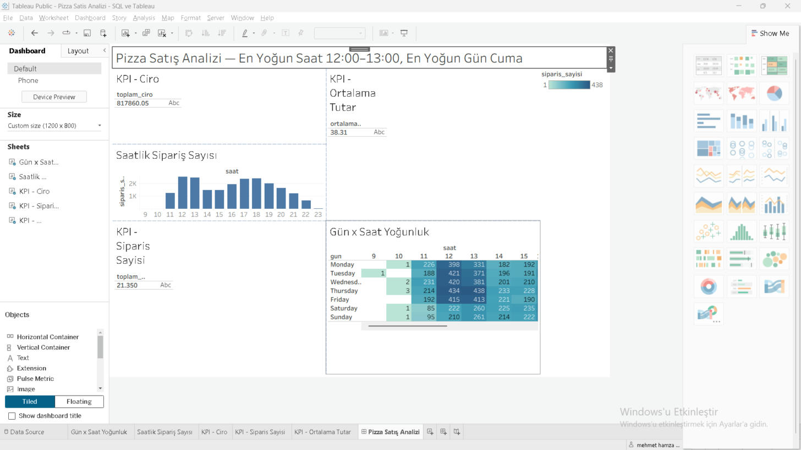

# Pizza Satış Analizi — SQL & Tableau

## Soru

Bir pizzacının yıllık cirosu ve sipariş sayısı ne kadar? Hangi gün ve
saatlerde yoğunluk var?

## Veri

[Maven Analytics — Pizza Place Sales](https://mavenanalytics.io/) veri
seti. Kullanılan tablolar:

- `orders.csv` — 21.350 sipariş (tarih, saat)
- `order_details.csv` — 48.620 sipariş satırı (sipariş içindeki pizzalar, adet)
- `pizzas.csv` — 96 pizza (boyut, fiyat)

`pizza_types.csv` bu projede kullanılmadı.

## Yöntem

1. **MySQL** — `pizza_kurulum.sql` ile veritabanı ve tablolar oluşturuldu,
   CSV'ler `LOAD DATA LOCAL INFILE` ile yüklendi.
2. **SQL analiz** — `pizza_analiz.sql` içinde `JOIN` (order_details ↔ pizzas,
   ciroyu hesaplamak için), `GROUP BY` (gün × saat kırılımı için) ve
   `COUNT(DISTINCT ...)` (bir siparişin birden fazla pizza satırı olduğunda
   tekrar sayılmaması için) kullanıldı.
3. **Tableau Public** — sorgu sonuçları CSV olarak dışa aktarılıp
   (`exports/` klasörü) tek sayfalık bir dashboard'a dönüştürüldü.

## Bulgular

- **Toplam ciro:** $817.860,05
- **Toplam sipariş sayısı:** 21.350
- **Sipariş başına ortalama tutar:** $38,31
- **En yoğun gün:** Cuma (3.538 sipariş) — en sakin gün Pazar (2.624 sipariş)
- **En yoğun saatler:** öğle arası 12:00–13:00 ve akşam 17:00–19:00
  (tek bir gün × saat kombinasyonunda en yüksek değer: Perşembe 13:00, 438 sipariş)

## Dashboard

[Pizza Satış Analizi — Tableau Public](https://public.tableau.com/app/profile/mehmet.hamza.k.r/viz/PizzaSatisAnalizi-SQLveTableau/PizzaSatAnalizi)



## Dosyalar

```
pizza-sql-tableau/
├── data/                       # Ham CSV veriler (orders, order_details, pizzas)
├── exports/                    # SQL sorgu sonuçlarından üretilen, Tableau'ya girdi olan CSV'ler
├── dashboard/                  # Dashboard ekran görüntüsü
├── pizza_kurulum.sql           # Veritabanı + tablo oluşturma + veri yükleme
├── pizza_analiz.sql            # Ciro, sipariş sayısı, ortalama, gün×saat sorguları
├── tableau_kurulum_rehberi.md  # Tableau dashboard'unu kurma adımları
└── README.md
```

## Kullanılan araçlar

MySQL (Workbench / komut satırı), Tableau Public
